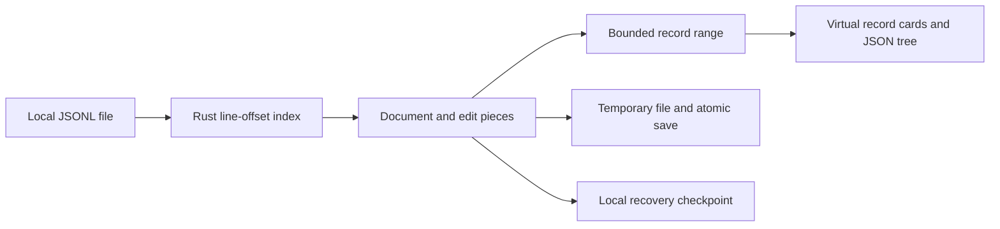

<div align="center">

# JSONL Studio

**Clear JSONL, one record at a time. Safe edits, on your desktop.**

A local desktop reader and lightweight editor for datasets, evaluations, Agent Traces and tool logs. Built with **Tauri 2 + Rust + React + TypeScript**, initially targeting macOS Apple Silicon and Arch Linux.

[](https://github.com/YiHarvest/JSONL-Studio/actions/workflows/ci.yml)
[](https://github.com/YiHarvest/JSONL-Studio/actions/workflows/release.yml)
[](LICENSE)

[Download](#download-and-install) · [Features](#features) · [Architecture](#architecture) · [Shortcuts](#shortcuts) · [Development](#development-and-validation) · [简体中文](README.md)

**[Download preview](https://github.com/YiHarvest/JSONL-Studio/releases)**

</div>

> **Current status:** `v0.1.0-beta.2` adds a collapsible workspace, live whole-file search, highlighted results and content font scaling. Release attachments are authoritative; macOS installers are published only after signing and notarization checks. Large-file performance targets remain under validation.

## Download and install

Installers contain the application code. **No Node.js, Rust or source checkout is required.**

| Platform            | Release attachment                             | Installation                                                  |
| ------------------- | ---------------------------------------------- | ------------------------------------------------------------- |
| Arch/Linux x86_64   | `JSONL-Studio_<version>_linux-x86_64.AppImage` | Make executable and launch                                    |
| macOS Apple Silicon | `JSONL-Studio_<version>_macos-aarch64.dmg`     | When a signed attachment is available, drag into Applications |
| Checksums           | `SHA256SUMS`                                   | Verify installer SHA-256                                      |

### Arch Linux

Download the AppImage from [Releases](https://github.com/YiHarvest/JSONL-Studio/releases). Allow execution in your file manager's properties, or run:

```fish
chmod +x ./JSONL-Studio_*_linux-x86_64.AppImage
./JSONL-Studio_*_linux-x86_64.AppImage
```

If FUSE 2 is needed: `sudo pacman -S fuse2`. Without FUSE, use `./JSONL-Studio_*_linux-x86_64.AppImage --appimage-extract-and-run`. AppImage normally does not register an application-menu entry or MIME associations automatically. Open or drag files into the app; native Arch packaging and AUR are still being prepared.

For a blank WebKit window, try:

```fish
env WEBKIT_DISABLE_DMABUF_RENDERER=1 LIBGL_ALWAYS_SOFTWARE=1 ./JSONL-Studio_*_linux-x86_64.AppImage
```

### macOS

Download the signed **Apple Silicon** DMG, drag into Applications, then launch JSONL Studio. Finder/Open With activation code is included; complete device verification is tracked in [validation](docs/validation.md). Intel/Universal installers are not available yet.

Public macOS packages require Developer ID signing, notarization and Staple. If no DMG is attached, that platform has not been published; Gatekeeper bypass is unnecessary.

### Verify downloads

Download `SHA256SUMS` and your installer into the same directory:

```fish
# Linux: check only downloaded attachments
sha256sum --ignore-missing -c SHA256SUMS
# macOS: compare the result to the matching SHA256SUMS entry
shasum -a 256 JSONL-Studio_*_macos-aarch64.dmg
```

## Features

| Capability           | Current implementation                                                            |
| -------------------- | --------------------------------------------------------------------------------- |
| One line, one record | Physical-line indexing and isolated invalid-line errors                           |
| Reading              | Tree, Pretty, wrapped Raw, single-line Raw and original source range              |
| Tree interaction     | Independent folding, Alt/Option recursion, depth controls, 50-child batches       |
| Import               | New document, paste JSON/JSONL, JSON-array conversion                             |
| Editing              | CodeMirror record editing, append, duplicate and delete                           |
| Search               | Loaded-range filter, whole-file Raw/Key/Value search, jump and expand hits        |
| Save                 | Temporary file, flush and atomic replacement; external conflicts refuse overwrite |
| Recovery             | Local checkpoints of applied edits                                                |
| Appearance           | Chinese/English, light/dark/system theme                                          |

Tree and Pretty preserve large numeric tokens. Saving retains unchanged bytes, including malformed records and line endings.

## Architecture



Rust owns authoritative file content. The frontend receives only a bounded range, including in All mode. See [architecture](docs/architecture.md) and [editing/save contracts](docs/m2.md).

## Shortcuts

| Action                 | macOS            | Linux                     |
| ---------------------- | ---------------- | ------------------------- |
| Open / New             | `⌘O` / `⌘N`      | `Ctrl+O` / `Ctrl+N`       |
| Save / Save As         | `⌘S` / `⇧⌘S`     | `Ctrl+S` / `Ctrl+Shift+S` |
| Find / Go to line      | `⌘F` / `⌘G`      | `Ctrl+F` / `Ctrl+G`       |
| Recursive node folding | `Option + click` | `Alt + click`             |

## Current limits

- Page: up to 1,000 lines / 8 MiB. Record preview/edit: 2 MiB. Paste: 8 MiB. Added edit buffers: 32 MiB.
- Search retains up to 500 hits. Key/Value search skips malformed and oversized preview records.
- Recovering disk edits requires the original source to remain unchanged; unapplied editor drafts are not checkpointed.
- 100 MB `<2 seconds`, 1 GB `<300 MB` and 50–60 FPS are targets, not certified results. See [benchmarks](docs/validation.md).
- GNOME/KDE associations, macOS device behavior and public installer qualification are verified separately.

## Development and validation

Development requires Node.js 22.12+, Rust stable and [Tauri prerequisites](https://v2.tauri.app/start/prerequisites/).

```fish
git clone https://github.com/YiHarvest/JSONL-Studio.git
cd JSONL-Studio
# Arch Linux development dependencies
sudo pacman -S --needed base-devel rust nodejs npm webkit2gtk-4.1 gtk3 librsvg patchelf
npm ci
npm run tauri dev
```

On macOS install Xcode Command Line Tools first: `xcode-select --install`.

```fish
npm run lint
npm run format:check
npm test
npm run build
npx playwright install chromium
npm run test:e2e
cargo fmt --manifest-path src-tauri/Cargo.toml --check
cargo clippy --manifest-path src-tauri/Cargo.toml --all-targets -- -D warnings
cargo test --manifest-path src-tauri/Cargo.toml
```

`npm run dev` previews paste/sample interactions in the browser. Desktop Rust handles disk reading and writing. Submit each functional module through a PR targeting `dev`; the maintainer merges manually and GitHub deletes the feature branch.

## Feedback and documents

[Report issues](https://github.com/YiHarvest/JSONL-Studio/issues) with your OS, version, reproduction steps and a synthetic or de-identified minimal sample.

[Product](docs/product.md) · [Tree interaction](docs/tree-interaction.md) · [Release](docs/release.md) · [Contributing](CONTRIBUTING.md) · [Security](SECURITY.md)

## License

[MIT](LICENSE) © YiHarvest. README presentation follows [oh-my-traex](https://github.com/YiHarvest/oh-my-traex): centered introduction, navigation and layered documentation.
