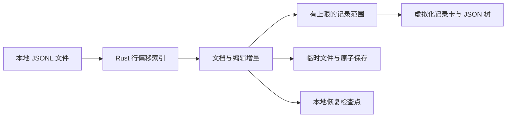

<div align="center">

# JSONL Studio

**让每一行 JSONL 清晰可读，让编辑安全留在本机。**

面向数据集、评测记录、Agent Trace 与工具日志的本地桌面阅读器和轻量编辑器。基于 **Tauri 2 + Rust + React + TypeScript**，首发面向 macOS Apple Silicon 与 Arch Linux。

[](https://github.com/YiHarvest/JSONL-Studio/actions/workflows/ci.yml)
[](https://github.com/YiHarvest/JSONL-Studio/actions/workflows/release.yml)
[](LICENSE)

[下载与安装](#下载与安装) · [核心能力](#核心能力) · [系统架构](#系统架构) · [快捷键](#快捷键) · [开发与验证](#开发与验证) · [English](README.en.md)

**[下载预览版 / Download preview](https://github.com/YiHarvest/JSONL-Studio/releases)**

</div>

> **当前状态：** 已实现阅读、记录编辑、全文件搜索、安全保存与本地恢复。首个安装包计划为 `v0.1.0-beta.1`，以 Releases 页面实际附件为准。macOS 下载包仅在签名、公证验证通过后提供。超大文件性能目标仍在验证。

## 下载与安装

安装包包含应用运行所需代码，**无需安装 Node.js、Rust 或克隆源码**。

| 平台                | 下载附件                                       | 安装方式                                     |
| ------------------- | ---------------------------------------------- | -------------------------------------------- |
| Arch/Linux x86_64   | `JSONL-Studio_<version>_linux-x86_64.AppImage` | 下载后赋予执行权限，双击运行                 |
| macOS Apple Silicon | `JSONL-Studio_<version>_macos-aarch64.dmg`     | 有已签名附件时，打开 DMG 并拖入 Applications |
| 校验文件            | `SHA256SUMS`                                   | 核对附件 SHA-256                             |

### Arch Linux

从 [Releases](https://github.com/YiHarvest/JSONL-Studio/releases) 下载 AppImage。在文件管理器的属性中允许作为程序执行，或者运行：

```fish
chmod +x ./JSONL-Studio_*_linux-x86_64.AppImage
./JSONL-Studio_*_linux-x86_64.AppImage
```

需要 FUSE 2 时：`sudo pacman -S fuse2`。没有 FUSE 时可用 `./JSONL-Studio_*_linux-x86_64.AppImage --appimage-extract-and-run`。AppImage 通常不自动加入应用菜单或注册文件关联；可从应用内打开或拖入文件。原生 Arch 包和 AUR 仍在准备。

如果出现空白窗口，可尝试：

```fish
env WEBKIT_DISABLE_DMABUF_RENDERER=1 LIBGL_ALWAYS_SOFTWARE=1 ./JSONL-Studio_*_linux-x86_64.AppImage
```

### macOS

下载 **Apple Silicon** 的已签名 DMG，拖入 Applications，然后启动 JSONL Studio。支持 Finder/Open With 文件激活的代码已接入，完整实机验证记录见 [平台说明](docs/validation.md)。尚未提供 Intel/Universal 安装包。

公开 macOS 包要求 Developer ID 签名、公证和 Staple；没有附件时表示这一平台尚未发布，不需要绕过 Gatekeeper。

### 校验下载

同时下载 `SHA256SUMS` 和对应安装包，在同一目录运行：

```fish
# Linux：只检查本地已下载附件
sha256sum --ignore-missing -c SHA256SUMS
# macOS
shasum -a 256 JSONL-Studio_*_macos-aarch64.dmg
```

macOS 将输出值与 `SHA256SUMS` 对应行比较。

## 核心能力

| 能力         | 当前实现                                                    |
| ------------ | ----------------------------------------------------------- |
| 一行一条记录 | 物理行索引，坏行独立展示错误与原文                          |
| 阅读模式     | 树形、Pretty、Raw 换行、Raw 单行、当前范围完整原文          |
| 树交互       | 独立折叠、Alt/Option 递归、层级控制、每批 50 个子项         |
| 数据导入     | 新建、粘贴 JSON/JSONL、JSON 数组转 JSONL                    |
| 编辑         | CodeMirror 单条编辑、新增、复制、删除                       |
| 搜索         | 当前范围快速筛选、全文件 Raw/Key/Value 搜索、命中跳转与展开 |
| 保存         | 临时文件、刷新、原子替换；外部修改冲突时拒绝覆盖            |
| 恢复         | 本地恢复检查点；保留已应用的编辑                            |
| 外观         | 简体中文/English、浅色/深色/跟随系统                        |

大整数在树形和 Pretty 中保留原始数值拼写。未修改记录保存时保留原始字节，包含坏行和换行符。

## 系统架构



前端只接收当前范围，Rust 保存权威文件内容；“全部”模式也按窗口继续读取。详细合同见 [架构](docs/architecture.md) 和 [编辑与保存](docs/m2.md)。

## 快捷键

| 操作          | macOS           | Linux                     |
| ------------- | --------------- | ------------------------- |
| 打开 / 新建   | `⌘O` / `⌘N`     | `Ctrl+O` / `Ctrl+N`       |
| 保存 / 另存为 | `⌘S` / `⇧⌘S`    | `Ctrl+S` / `Ctrl+Shift+S` |
| 查找 / 跳转行 | `⌘F` / `⌘G`     | `Ctrl+F` / `Ctrl+G`       |
| 递归折叠节点  | `Option + 点击` | `Alt + 点击`              |

## 当前边界

- 单次读取最多 1,000 行 / 8 MiB，记录预览及编辑最多 2 MiB；粘贴最多 8 MiB、编辑增量最多 32 MiB。
- 搜索最多保留 500 个命中；Key/Value 搜索跳过无法解析或超出预览上限的记录。
- 恢复磁盘编辑要求原文件仍存在且未修改；尚未应用的编辑器草稿不进入恢复检查点。
- 100 MB `<2 秒`、1 GB `<300 MB` 和 50–60 FPS 仍是目标，完整基准结果见 [验证记录](docs/validation.md)。
- GNOME/KDE 文件关联、macOS 实机和公开安装包资格按平台分别验证。

## 开发与验证

开发需要 Node.js 22.12+、Rust stable 与 [Tauri 平台依赖](https://v2.tauri.app/start/prerequisites/)。

```fish
git clone https://github.com/YiHarvest/JSONL-Studio.git
cd JSONL-Studio
# Arch Linux 开发依赖
sudo pacman -S --needed base-devel rust nodejs npm webkit2gtk-4.1 gtk3 librsvg patchelf
npm ci
npm run tauri dev
```

macOS 先安装 Xcode Command Line Tools：`xcode-select --install`。

```fish
npm run lint
npm run format:check
npm test
npm run build
npx playwright install chromium
npm run test:e2e
cargo fmt --manifest-path src-tauri/Cargo.toml --check
cargo clippy --manifest-path src-tauri/Cargo.toml --all-targets -- -D warnings
cargo test --manifest-path src-tauri/Cargo.toml
```

`npm run dev` 只提供浏览器粘贴/样例预览；磁盘读写使用桌面程序。功能修改分支通过 PR 合入 `dev`，维护者手动合并后自动删分支。

## 反馈与文档

[提交问题](https://github.com/YiHarvest/JSONL-Studio/issues)时请提供操作系统、版本、复现步骤与脱敏最小样例。

[产品范围](docs/product.md) · [树交互](docs/tree-interaction.md) · [发布流程](docs/release.md) · [贡献](CONTRIBUTING.md) · [安全](SECURITY.md)

## 许可证

[MIT](LICENSE) © YiHarvest。README 排版参考 [oh-my-traex](https://github.com/YiHarvest/oh-my-traex) 的居中标题、导航和分层说明结构。
