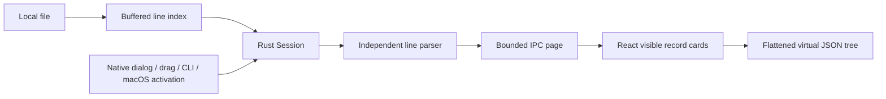

# Architecture

## Ownership and modules

Rust `core::Session` owns the authoritative source: disk path plus metadata fingerprint and offsets, or bounded scratch bytes. A `Vec<u64>` stores start offsets and one EOF sentinel. Buffered scanning uses `memchr`, not a fully loaded byte buffer.

The initial design proposed `memmap2`; M1 deliberately uses seek/read and a buffered index. A mapping of a mutable external file can fault when another process truncates it. Buffered reads fail normally, and stamps checked before/after indexing and reading reject stale snapshots. mmap can be evaluated later with a documented safe snapshot strategy and benchmarks.

Tauri state contains an `Arc<Mutex<Document>>`. The document references an `Arc<Session>` plus ordered source ranges and added record buffers. Reads, edits and saves run outside the event loop. Search clones a document snapshot and releases the lock before scanning. A completed open/import replaces the document. `pending_files` retains startup activation until the frontend subscribes. The single-instance plugin routes subsequent Linux launches. macOS opened-file events use file URL conversion.

React owns a bounded page plus preferences, virtualizer state and per-line folding. It never reads a disk file with browser APIs. Both record cards and tree rows are virtualized. Parsed trees exist for mounted record cards only. Nodes are flattened from expanded children, with 50-child increments.

## IPC

| Command         | Input                       | Output                     |
| --------------- | --------------------------- | -------------------------- |
| `open_file`     | path                        | Info                       |
| `import_text`   | text ≤8 MiB                 | Info                       |
| `read_page`     | 1-based start, count 1–1000 | records, nextLine, hasMore |
| `file_changed`  | none                        | bool                       |
| `validate_file` | none                        | valid/error pair           |
| `pending_files` | none                        | queued paths, drained      |

`Record.json` is validated JSON **text**, never a JavaScript JSON object. A frontend tokenizer preserves integer/exponent source tokens, escaped strings and duplicate keys. `raw` omits the physical terminator/BOM; `source` retains the returned source text and terminator. Errors include the parser message and column. Oversized records return truncated previews with an explicit error.

## Limits

Index memory is O(lines), approximately 8 bytes per line before allocator spare capacity. Source bytes stay on disk. IPC input budget is 8 MiB, with bounded extra JSON/string serialization overhead. Tree depth is at most 128; flattened visible rows are guarded at 10,000. Children are loaded in batches of 50.

All-mode navigates bounded windows rather than maintaining an unbounded page cache. Full-file validation is manual and runs in a background task. M2 search scans bounded batches with progress and a stop control.

## M2 implementation

`document.rs` owns revision-checked edits, source-piece serialization, bounded search, atomic Save/Save As and recovery checkpoints. See [M2 contracts](m2.md) for byte preservation, destination conflict handling, source metadata checks and recovery limitations. Frontend CodeMirror is loaded on demand and never owns the full disk document.

## Privacy

No telemetry, remote API, external font or web image. CSP restricts content to application assets and local IPC. Capabilities allow native dialog and core window/event behavior; there is no generic frontend filesystem, shell or HTTP plugin.
